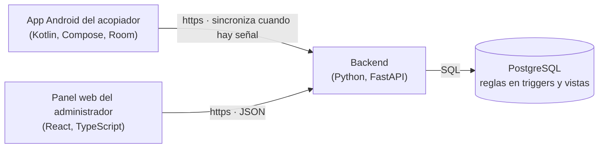
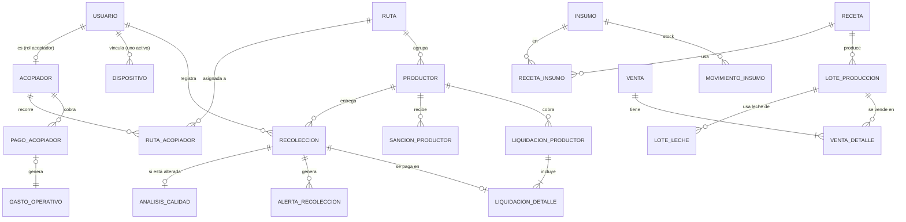

# Informe: material base

> Material para redactar el informe del sistema de acopio y producción de la quesería de Huata (Puno). Escrito con
> lo que hay en el repositorio al 20/10/2026. Sin contraseñas, claves, direcciones IP ni nombres de equipos o de
> la red. Las cifras de pruebas son de ese día.

## 1. El cliente y el problema
La quesería de Huata (Puno) produce queso paria, queso pasteurizado, queso fresco y, por temporada, yogurt. Su
materia prima es la leche que **acopiadores** recogen cada mañana, casa por casa, en **rutas rurales sin señal de
internet**. En el acopio se paga por litro a cada productor, pero la leche puede llegar **alterada** (aguada,
ácida o con antibióticos): esa leche se descarta y el productor recibe una sanción.

Antes del sistema el registro era en cuaderno. Eso traía tres problemas:
- **No había respaldo de lo recibido**: una entrega podía anotarse mal o dos veces, y no había cómo comprobar
  dónde y a qué hora se recogió.
- **Las reglas se aplicaban a mano**: precio normal o de sanción, bloqueos por reincidencia, pagos retenidos.
  Fácil de olvidar y difícil de explicar al productor.
- **No se sabía cuánto costaba cada queso ni cuánto se ganaba**: la leche, los insumos y los gastos no estaban en
  un mismo lugar.

El sistema registra cada entrega en el celular del acopiador **aunque no haya señal**, la sube cuando hay, aplica
las reglas en la base de datos y le da al administrador un panel web para revisar, producir, vender y pagar.

## 2. Arquitectura y tecnologías

| Pieza | Tecnología | Por qué |
|---|---|---|
| App del acopiador | Android nativo: Kotlin, Jetpack Compose, Room (base local), WorkManager (envío en segundo plano), Android Keystore (claves) | Tiene que funcionar **sin internet**: Room guarda todo en el celular y WorkManager lo envía solo cuando vuelve la señal. El Keystore guarda la clave que firma cada registro sin que se pueda copiar. Los celulares de campo son Android. |
| Backend | Python 3, FastAPI, psycopg | API pequeña y clara, con validación automática de los datos de entrada y documentación de la API generada sola. No duplica reglas: inserta, consulta vistas y traduce los errores de la base a mensajes claros. |
| Base de datos | PostgreSQL | **"La base manda"**: precios, sanciones, bloqueos, retenciones de pago, stock, costos y resultados viven en la base como triggers, vistas y restricciones. Así ninguna pantalla puede saltarse una regla. |
| Panel web | React con TypeScript, compilado con Vite | Pantallas de tablas y formularios para una persona en una laptop. TypeScript revisa que la web use exactamente los campos que da la API (los tipos se generan desde el backend). Gráficos y mapa con SVG propio, sin librerías externas. |

## 3. Roles
| Rol | Dónde trabaja | Qué hace |
|---|---|---|
| **Administrador** | Panel web, con correo y contraseña | Gestiona todo: acopiadores, analistas, rutas y productores; revisa alertas y calidad (mientras no exista la app del analista); produce, vende, compra insumos, registra mermas y gastos; liquida y paga a productores y acopiadores; configura precios y parámetros. |
| **Acopiador** | App del celular, con PIN | Registra la leche que recibe de los productores **de su ruta**, aun sin señal; puede dar de alta un productor nuevo en el campo (queda pendiente de aprobación); ve su día y sus envíos. Cobra un sueldo mensual más una comisión por litro normal. |
| **Analista** | App del celular, con PIN (pantallas pendientes) | Revisa la calidad de cada entrega: por defecto normal; si está alterada, registra su análisis (pH, temperatura, grasa, densidad, antibióticos o foto). Registra productores externos. Hoy el administrador hace esta revisión desde el panel; el servidor ya tiene lo necesario (ver sección 10). |

## 4. Requisitos funcionales
| # | Requisito | Estado |
|---|---|---|
| 1 | Vincular el celular una sola vez con un código del administrador y entrar con PIN | Hecho |
| 2 | Registrar entregas sin señal (litros, observación, GPS, hora) y enviarlas solas al volver la señal | Hecho |
| 3 | Aviso rojo de productor bloqueado sin impedir el registro (la base retiene el pago) | Hecho |
| 4 | Alta de productor en el campo, pendiente de aprobación | Hecho |
| 5 | Panel web con sesión del administrador | Hecho |
| 6 | Acopiadores (DNI, celular, color, vehículo, sueldo, comisión), analistas y rutas | Hecho |
| 7 | Productores: lista con total acumulado y detalle de entregas; aprobar altas de campo | Hecho (el desglose por rango de fechas, parcial) |
| 8 | Entregas del día con resumen por persona, filtros, anulación con motivo y **mapa** | Hecho (mapa propio, sin calles) |
| 9 | Alertas (sin GPS, ubicación simulada, lejos del productor, firma inválida, productor bloqueado, etc.) y su revisión | Hecho |
| 10 | Control de calidad: normal por defecto, alterada con análisis y foto opcional; sanción automática | Hecho desde el panel; app del analista: **fase siguiente** |
| 11 | Leche de la jornada y registro de merma | Hecho |
| 12 | Almacén de insumos con costo promedio, compras e insumos nuevos | Hecho (ajustes de inventario: fase siguiente) |
| 13 | Recetas: ver, crear, editar y duplicar | Hecho |
| 14 | Producción de un lote y venta al contado | Hecho en versión rápida (lotes por etapas y ventas de varias líneas: fase siguiente) |
| 15 | Pagos semanales a productores (liquidación, comprobante, pagar) | Hecho |
| 16 | Pagos mensuales a acopiadores (sueldo estimado, ajustes, pagar) | Hecho |
| 17 | Gastos y libro de movimientos del mes | Hecho |
| 18 | Resumen del mes: flujo de caja y resultado, con gráficos | Hecho |
| 19 | Configuración: precio de la leche con historial y parámetros | Hecho |
| 20 | **App o acceso del analista** | **Fase siguiente**: el servidor ya tiene la revisión de calidad, la foto y el alta de externos; falta el acceso del analista y su decisión de seguridad (sección 10) |
| 21 | Historial de cambios (auditoría) en pantalla | Fase siguiente (la base ya lo registra) |

## 5. Reglas de negocio
Todas viven en la base de datos (`db/schema.sql`); el backend y las pantallas solo las muestran.

- **Precio de la leche al productor:** normal **S/ 1.70 por litro**; de sanción **S/ 0.70**. El administrador puede
  cambiarlos; cada cambio queda en un historial con su fecha de vigencia y no se borra.
- **Solo se paga la leche revisada:** una entrega pasa a "pagable" recién cuando la calidad está revisada y no
  está retenida.
- **Leche alterada:** se descarta (no entra a producción). Por defecto se paga a precio normal (parámetro
  `pagar_leche_alterada`), y su costo lo absorbe la leche buena del día. Marcarla alterada exige su análisis
  (al menos un dato o la foto).
- **Sanción de 7 días:** si el día D una entrega se marca alterada, el productor recibe precio de sanción del
  **D+1 al D+7**.
- **Bloqueo por reincidencia:** si se vuelve a alterar durante la sanción o hasta 7 días después de que terminó,
  el productor queda **bloqueado del D+1 al D+7** (la semana se reinicia). Después vuelve al precio normal. Un
  productor bloqueado no debería entregar; si el acopiador igual recibe su leche, se registra, la base crea una
  alerta y **retiene el pago** hasta que el administrador la revise.
- **Retenciones:** el pago de una entrega queda retenido si el productor no está aprobado (alta de campo), si
  vino de un productor bloqueado o si su firma no es válida. Lo decide el administrador al revisar la alerta.
- **Pagos a productores:** semanales, por **liquidación** de un periodo (por defecto, lunes a domingo de la semana
  anterior). Los montos se congelan al liquidar; una liquidación pagada no se edita ni se borra, y una entrega
  liquidada no se puede anular.
- **Pagos a acopiadores:** mensuales: **sueldo base + comisión por litro normal** + ajustes. Al pagarse genera su
  gasto "Sueldo acopiador".
- **Mermas:** solo se puede mermar leche aprobada que no esté en un lote ni en otra merma. Su pérdida (litros ×
  costo por litro útil del día) entra al resultado del mes; no cambia el flujo de caja.
- **Costo promedio de insumos:** cada compra recalcula el costo promedio ponderado:
  (stock × costo actual + cantidad comprada × costo de compra) ÷ (stock + cantidad comprada).
- **Costo de un lote:** la leche (al costo por litro útil de su día) + los insumos consumidos (a su costo
  promedio) + sus costos propios. Un lote cerrado no se altera.
- **Ventas:** solo al contado, de lotes cerrados, con saldo y sin vencer. Los quesos se cuentan por **unidad** y el
  yogurt por **kilo**.
- **Resultado y flujo del mes:** el **flujo** cuenta el dinero que entra y sale (incluye compras de insumos en su
  mes); el **resultado** cuenta lo que se ganó (ventas − costo de lo vendido − pérdidas − gastos): el inventario
  sin vender no es gasto todavía.
- **GPS:** siempre se guarda y **nunca bloquea** el registro; lo sospechoso se marca con alertas.
- **Hora de negocio:** America/Lima. **Moneda:** soles, con 2 decimales.

## 6. Modelo de datos
Tablas principales (simplificado; en total la base tiene 31 tablas y 17 vistas):

- **Acopio:** `usuario` (administrador, acopiador, analista), `dispositivo`, `ruta`, `ruta_acopiador` (con fechas),
  `productor`, `recoleccion` (cada entrega, con su UUID, GPS, hora y firma), `analisis_calidad`,
  `alerta_recoleccion`, `sancion_productor`.
- **Pagos:** `precio_leche` (historial), `liquidacion_productor` y `liquidacion_detalle` (montos congelados),
  `pago_acopiador`.
- **Planta:** `insumo`, `movimiento_insumo` (el stock es la suma de movimientos), `receta`, `receta_insumo`,
  `lote_produccion`, `lote_leche`, `lote_costo`, `merma_leche`, `baja_producto`.
- **Ventas y dinero:** `cliente`, `venta`, `venta_detalle`, `gasto_operativo`, `categoria_gasto`.
- **Sistema:** `configuracion` (parámetros), `auditoria` (quién cambió qué y cuándo).
- **Vistas que hacen los cálculos:** `v_recoleccion_pago` (precio y si es pagable o retenida), `v_leche_jornada`
  (leche del día y costo por litro útil), `v_insumo_stock`, `v_lote_resumen`, `v_flujo_mensual`,
  `v_resultado_mensual`, entre otras.

## 7. Módulos del panel web
El menú tiene Inicio, Resumen y Productores arriba; los grupos **Revisión**, **Personal**, **Planta** y **Dinero**
(se pliegan; queda abierto el de la pantalla actual); y Configuración al pie. La columna "Captura" sugiere el mejor
momento para tomar la imagen del informe.

| Módulo | Qué muestra | Qué permite | Reglas que cumple | Captura |
|---|---|---|---|---|
| **Entrar** | Foto de fondo y tarjeta con el logo | Entrar con correo y contraseña | 10 intentos fallidos desde la misma dirección en 10 min → espera; después de entrar, siempre a Inicio | Con la pantalla vacía |
| **Inicio** | Franja "Requiere atención" y 4 pasos numerados: Recibir leche, Producir, Vender, Pagar, con su cifra | Ir a cada tarea; el paso con pendientes se resalta en dorado | Cifras sacadas de las vistas de la base | Con entregas sin revisar (paso 1 resaltado) |
| **Resumen** | Leche y dinero del mes con cifras grandes, gráfico del flujo y de la leche de 14 días | Elegir el mes; abrir "Ver detalle" | Flujo y resultado calculados por la base | Un mes con ventas y compras, con "Ver detalle" abierto |
| **Productores** | Lista con total acumulado, altas pendientes primero | Crear, editar, aprobar altas de campo; ver sus entregas | Al aprobar se libera la retención por "no aprobado" | Con un alta de campo pendiente |
| **Entregas del día** | Entregas del día con resumen por persona; vista **Mapa** | Filtrar (por revisar, con alertas, anuladas), ver en el mapa, abrir en Google Maps, anular con motivo | El GPS no bloquea; la distancia a la referencia la calcula la base; una liquidada no se anula | Vista Mapa con una entrega "lejos" |
| **Alertas** | Alertas pendientes o todas | Revisar con resolución | Revisar libera el pago retenido | Con una alerta de productor bloqueado |
| **Calidad** | Entregas por revisar | Marcar normales en lote; alterada con análisis y foto | Alterada exige análisis; la base crea sanción o bloqueo | La ventana "Marcar como alterada" |
| **Leche del día** | Por día: recolectada, descartada, aprobada, en lotes, merma, disponible y costo por litro útil | Registrar merma | La merma no puede superar lo disponible | Después de registrar una merma |
| **Acopiadores / Analistas** | Lista con estado del celular | Crear, editar, generar código de activación, desactivar celular | Un solo celular activo por usuario; el código es de un solo uso y vence en 60 min | La ventana del código de activación |
| **Rutas** | Rutas y su acopiador vigente | Crear, asignar y cambiar acopiador con fecha | Una ruta tiene un solo acopiador vigente | Detalle de una ruta con su historial |
| **Producción** | Recetas activas y leche disponible | Producir un lote en un paso | Leche aprobada y stock suficientes; el lote se cierra | Vista previa con "necesita / hay" |
| **Ventas** | Lotes con saldo | Vender al contado | No se vende más del saldo ni lotes vencidos | Después de una venta |
| **Almacén** | Insumos tipo kardex: cantidad grande y estado ("Sin stock", "Alcanza para ≈ N L") | Registrar compras y crear insumos | Costo promedio ponderado de la base | Con un insumo sin stock |
| **Recetas** | Insumos por 100 L, costo y alcance | Crear, editar y duplicar con vista previa | Con lotes hechos no cambian unidad, litros base, rendimiento ni vida útil | Editor con la vista previa |
| **Pagos a productores** | Por pagar y liquidaciones | Liquidar periodo, comprobante, marcar pagada | Montos congelados; pagada no se edita | El comprobante imprimible |
| **Sueldos de acopiadores** | Estimado del mes por acopiador | Registrar con ajustes y pagar | Al pagar crea el gasto "Sueldo acopiador" | Con un pago pendiente |
| **Gastos** | Gastos del periodo por categoría | Registrar gastos | El sueldo solo lo crea su pago | Con varias categorías |
| **Movimientos** | Libro del mes: ingresos, egresos y pérdidas | Filtrar por mes y tipo | Concilia con el flujo y el resultado de la base | Un mes completo |
| **Configuración** | Precio de la leche y parámetros | Programar un precio nuevo y editar parámetros | El historial de precios no se borra | El historial de precios |

## 8. App del acopiador
- **Vincular el celular (una vez):** el administrador genera un código de 8 caracteres (un solo uso, vence en 60
  minutos). En el celular se escribe el código y la persona **crea su PIN de 4 dígitos** (se rechazan los PIN
  fáciles, como 1111 o 1234). Al vincular, el celular genera una clave en el **Android Keystore** y envía al
  servidor solo la parte pública.
- **Entrar con PIN:** teclado con dígitos mezclados; se verifica al cuarto dígito. Cinco PIN incorrectos bloquean
  15 minutos.
- **Mi jornada y mi ruta:** arriba, los litros del día y cuántos productores ya entregaron; debajo, los productores
  de su ruta. Un productor sancionado o bloqueado aparece **en rojo**.
- **Registrar leche:** litros con un teclado grande y una observación opcional. La app toma sola la **hora**, la
  **ubicación GPS** (con su precisión), si la ubicación es simulada y si la hora del celular es automática. **Sin
  GPS se registra igual.** Cada registro se **firma** con la clave del Keystore y se encadena con el anterior.
- **Productor bloqueado:** aviso rojo "Productor bloqueado, no debe entregar leche"; si el acopiador confirma que la
  recibió, se registra igual y la base retiene el pago.
- **Sin señal:** todo se guarda en el celular (Room). Cada registro tiene su propio identificador (UUID), así que
  si se envía dos veces el servidor no lo duplica.
- **Sincronización:** se envía sola cuando hay señal (WorkManager) o con "Sincronizar ahora". Primero suben las
  altas de productores y después sus entregas. La pantalla de sincronización dice qué se envió y qué se rechazó, y
  por qué. "Mi día" y "Últimos días" juntan lo del servidor con lo pendiente del celular sin contarlo dos veces.

## 9. Seguridad y pruebas
**Seguridad**
- **Sesión del administrador:** token firmado con vencimiento; vive en la pestaña del navegador (se borra al
  cerrarla). Al vencer, el panel vuelve a Entrar; el aviso de vencimiento aparece en los últimos 5 minutos.
- **Contraseñas y PIN:** se guardan cifrados (bcrypt), nunca en texto. Los códigos de activación se guardan solo
  como huella (HMAC).
- **Límites de intentos:** 10 contraseñas o códigos incorrectos desde la misma dirección en 10 minutos → espera; 5 PIN
  incorrectos → bloqueo de 15 minutos.
- **Firma de dispositivo:** cada entrega se firma en el celular (ECDSA P-256 con SHA-256, clave en el Keystore). El
  servidor verifica la firma con la clave pública del celular; si no coincide, crea una alerta y retiene el pago.
- **Un solo celular activo por usuario;** el administrador puede desactivarlo.
- **Roles en el servidor:** cada endpoint exige su rol; la base además impide que un acopiador registre productores
  externos o que alguien sin rol de analista o administrador fije la calidad.
- **Panel web:** política de seguridad de contenido (CSP) estricta (solo recursos del propio sitio y de la API),
  sin estilos en línea ni scripts de terceros; CORS limitado al origen del panel.
- **Auditoría:** cada transacción registra quién la hizo; precios, sanciones, pagos, ventas y cambios quedan en
  el historial.

**Pruebas** (cifras del 20/10/2026)
| Parte | Pruebas |
|---|---|
| Base de datos (`db/tests/escenarios.sql`) | 99 comprobaciones de reglas (sanciones, bloqueos, pagos, stock, lotes) |
| Backend (pytest, contra una base de pruebas aparte) | 154 |
| Panel web (Vitest y Testing Library, con la API simulada) | 405 |
| App Android (pruebas unitarias e instrumentadas) | 189 |

- **Pruebas de mutación:** en cada bloque se introdujeron a propósito errores en el código (por ejemplo, contar mal,
  saltarse una regla, mandar el campo equivocado) para comprobar que alguna prueba falla. Si una mutación no se
  detectaba, se reforzaba la prueba. Así se encontraron pruebas que "pasaban" sin comprobar nada.
- Cada cambio se verificó con la suite completa **dos veces**, el chequeo de tipos de TypeScript y la compilación.

## 10. Limitaciones y trabajo futuro
- **Acceso del analista (fase siguiente).** Decisión: **correo y contraseña propios del analista**, un inicio de
  sesión web (`/auth/web/login`) y un token marcado como "web". Estimación: **≈ 6.5 h** (backend: acceso 1.25 h,
  permisos 1 h, pruebas 1 h; web: sesión y menú 1.25 h, pantallas 1 h, pruebas 1 h), **≈ 8 h** con el alta de
  productores externos. Permisos del analista: solo las entregas **del día**, la lista por revisar, marcar la
  calidad con análisis y foto. Riesgos: abrir con cuidado el control de tokens (hoy rechaza a quien no es
  administrador y no tiene celular), una credencial más expuesta (con límite de intentos) y que una entrega
  registrada desde la web no tendría firma de dispositivo (por eso queda fuera). No requiere cambios en la base.
- **Mapa con calles** (Leaflet con OpenStreetMap) y **mapa de rutas**; hoy el mapa es propio y sin fondo.
- **Producción y ventas completas:** lotes por etapas con leche de varias jornadas, ventas de varias líneas, bajas
  de producto y ajustes de inventario; stock mínimo por insumo.
- **Protecciones pendientes en la base** (hoy las cubre el backend): borrar una liquidación pagada, el gasto del
  pago al acopiador y no cambiar recetas con lotes (parches 003 y 004 propuestos).
- **App sin señal varios días:** el nombre en rojo de un productor sancionado se actualiza al sincronizar; para
  cambiar el día exacto sin señal, la app debería comparar las fechas de la sanción.
- **Historial de cambios** en pantalla, comprobante en PDF, pulido visual de Alertas, Pagos y Movimientos.
- **Datos de ejemplo:** días de vida útil, rendimientos, insumos y costos, sueldos y rutas reales los confirma el
  cliente; todo se edita desde el panel.

## 11. Conexión de la app del celular con el servidor

### 11.1 Cómo se conecta hoy el celular (Realme) al backend
- La app del acopiador habla con el backend por internet usando **Tailscale**, una red privada entre equipos (la
  "tailnet"): el teléfono y la laptop donde corre el backend tienen Tailscale **encendido y con sesión iniciada**
  en la misma red. Si cualquiera de los dos lo tiene apagado, la app no llega al servidor: guarda todo en el celular
  (funciona sin señal) y lo envía cuando vuelve la conexión.
- La laptop tiene en la tailnet un **nombre estable** (de la forma `equipo.red.ts.net`) con **certificado https**
  emitido para ese nombre. Ese nombre no cambia aunque la laptop cambie de wifi o de red, así que la app no necesita
  otra dirección.
- **Compartir con otras cuentas:** Tailscale permite compartir solo ese equipo con cuentas de otras personas (por
  ejemplo, otro acopiador con su propio teléfono) sin darles acceso al resto de la red. Cada persona instala
  Tailscale, acepta lo compartido y tiene que tenerlo encendido igual que el teléfono de prueba.
- **Batería de Android:** la optimización de batería puede cerrar Tailscale en segundo plano (más en algunos
  fabricantes). Entonces la app muestra que no hay conexión aunque el teléfono tenga datos. Conviene excluir
  Tailscale de la optimización de batería y activar la "VPN siempre activa" de Android para Tailscale.

### 11.2 La dirección del servidor queda fija en la APK
- La dirección del backend se escribe en `mobile/local.properties` (clave `api.base.url`, fuera de git) y, **al
  compilar**, queda dentro de la APK (`BuildConfig.API_BASE_URL`). La app no tiene una pantalla para cambiarla:
  **cambiar de servidor exige compilar e instalar una APK nueva**.
- La APK actual es la **0.7.0** (versión de código 5), una compilación de depuración.

### 11.3 La APK exige https
- `network_security_config.xml` prohíbe el tráfico sin cifrar (`cleartextTrafficPermitted="false"`) y no tiene
  excepciones: la app **solo acepta direcciones https** con un certificado válido. Por eso se usa el nombre de
  Tailscale con su certificado, y no la dirección de la laptop en la red local.

### 11.4 Por qué el panel web sí se prueba por la red local y la app no
- El **panel web** es una página que el navegador abre con la dirección que se escriba en ese momento: se puede
  probar en la propia laptop o desde otro equipo de la red local sin recompilar nada, y el navegador acepta
  `http` local para pruebas.
- La **app** lleva la dirección fija dentro de la APK y exige https con certificado válido: una dirección de la red
  local (`http://…`) no se puede usar sin cambiar `local.properties`, permitir `http` en la configuración de red y
  recompilar. Para probar con el celular se usa el mismo nombre https de Tailscale que en el campo.
